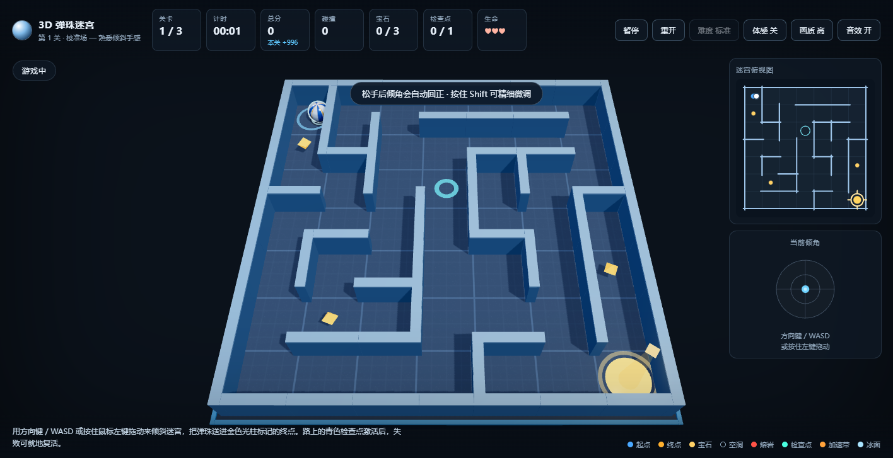
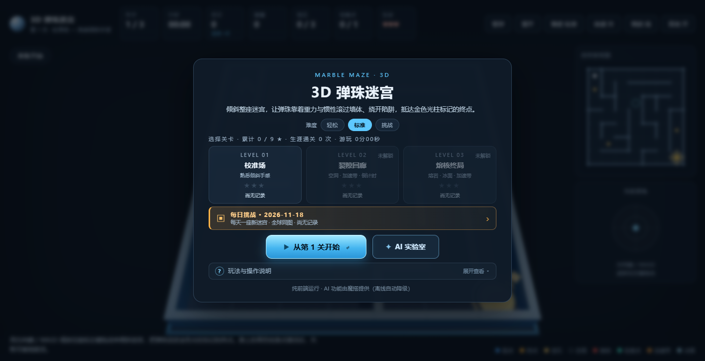
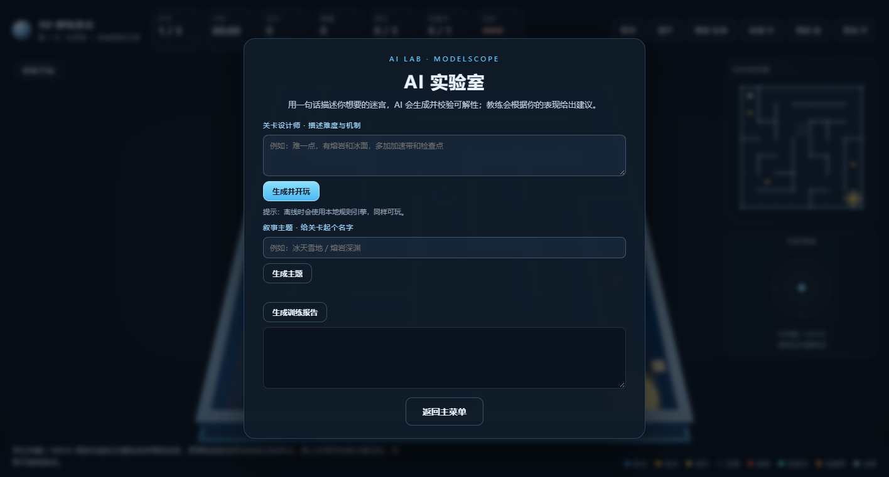
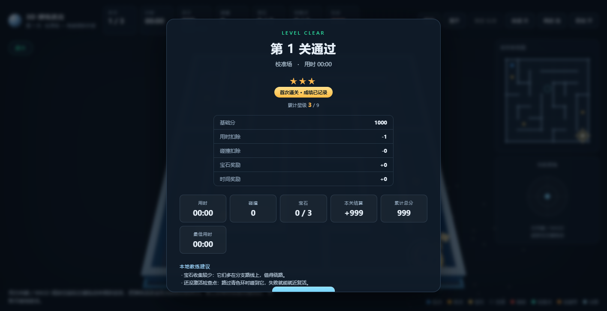
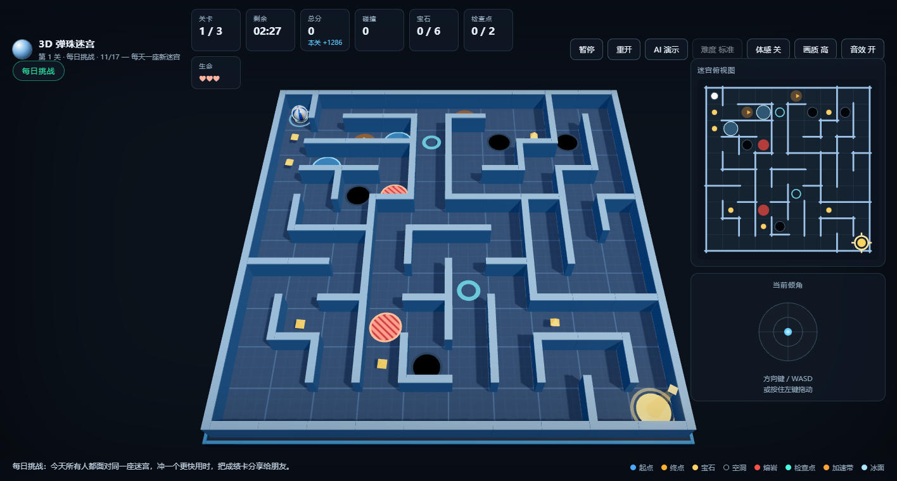
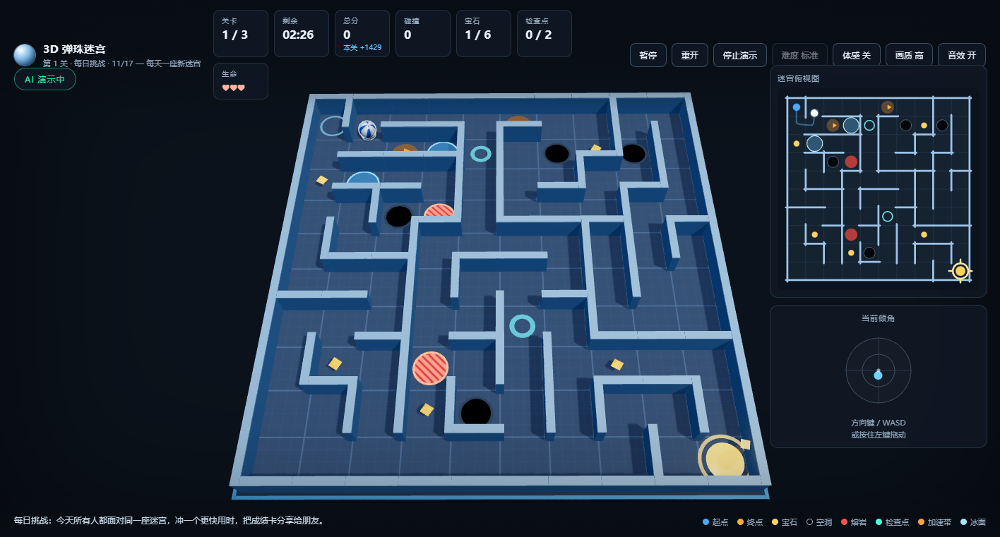

# 3D 弹珠迷宫 · Marble Maze 3D

[](https://github.com/hutuboy/marble-maze-3d/actions/workflows/ci.yml)
[](LICENSE)
[](#技术方案)
[](#验证基线)

> **AI+∞ 开发者创作大赛第三期「AI 造游戏」参赛作品**
> 在线试玩（魔搭创空间，AI 功能与云存档已启用）：**https://www.modelscope.cn/studios/hutuboy/marble-maze-ai**
> 本地双击 `index.html` 也能完整游玩，AI 功能会自动降级为本地规则引擎；云存档/排行榜仅线上可用，本地不影响离线体验。



| 主菜单 | AI 实验室 | 通关结算 |
| --- | --- | --- |
|  |  |  |

| 每日挑战 | AI 自动试玩演示 |
| --- | --- |
|  |  |

> **演示视频**（七段分镜 + 中文解说、实机捕获）：[docs/演示视频.mp4](docs/演示视频.mp4)，已发布[小红书](https://www.xiaohongshu.com/discovery/item/6afc1331000000002501e322?source=webshare&xhsshare=pc_web&xsec_token=GBLZpfx3PIoJO5SMuflIu4pPAWBbvqtkHNVi5ui2Sm6dI=&xsec_source=pc_share)；制作管线见 `tools/video/`。

## 30 秒上手

```bash
git clone https://github.com/hutuboy/marble-maze-3d.git
cd marble-maze-3d
# 方式一：直接双击 index.html（无需任何安装）
# 方式二：用自带静态服务器
npm start          # 打开 http://localhost:5173
```

改完 `src/` 后跑 `npm run build` 重新打包；`npm test` 是纯 Node 验证（不需要浏览器）。

## 技术方案

- **渲染**：Three.js 0.187.0，已通过 esbuild 打包进 `game.bundle.js`，运行时不请求任何 CDN。
- **物理**：自研确定性求解器（固定 120 Hz 步长 + 子步连续碰撞检测，圆 vs AABB 墙体），含倾斜重力投影、惯性、滚动阻尼、法向反弹与切向滑动；加速带冲量、冰面低摩擦也在同一求解器内实现，未使用第三方物理引擎。
- **资源**：地板/弹珠/熔岩纹理、环境反射贴图、迷宫几何、加速带箭头、终点粒子、全部音效均由 Canvas / Three.js 几何体 / WebAudio 在运行时程序化生成，无图片、模型、音频文件。
- **AI**：`src/ai.js` 提供设计师 / 教练 / 叙事 / 训练报告四项能力，经魔搭创空间后端 `studio/app.py` 代理调用 Qwen 模型链（带降级与配额闸门）；token 只作服务端 secret，前端永不持有。离线自动降级为规则引擎。
- **云存档 / 排行榜**：`src/cloud.js` + `studio/app.py` 提供免注册云能力。后端给每台设备签发一个匿名 HttpOnly Cookie（`mm_uid`），用户名由 uid 经 FNV-1a **稳定派生**（如「疾风刺猬07」），无需注册也不存名字表；成绩落在创空间持久化目录 `/mnt/workspace`，原子写入 + 文件锁，逐项取历史最优防回退。主线通关自动上云，自定义/每日/演示关卡不写榜。本地模式零请求、静默降级。
- **产物**：`index.html` + `styles.css` + `game.bundle.js` + `favicon.svg` 即可完整运行；`src/` 为可读源码，`studio/` 为创空间部署源，`package.json` 提供重新构建与本地服务脚本。

## 启动

- 最简单：**双击 `index.html`**（`file://` 下可直接运行，已验证无需服务器）。
- 或：`npm start` / Windows 双击 `start.bat`，然后打开 `http://localhost:5173`。
- 修改源码后重新构建：`npm run build`（依赖已在 `node_modules`，离线可用）。
- 验证：`npm test`（关卡可解性、防穿墙、新机制、自动通关、成绩模块，纯 Node）；`npm run test:browser`（无头 Edge 全流程与零错误检查，需本机 Edge）；`npm run shots`（生成实拍截图）。

## 操作

| 输入 | 作用 |
| --- | --- |
| W A S D / 方向键 | 倾斜迷宫，松手自动回正 |
| Shift + 方向 / 拖动 | 精细微调（倾角减至 42%），用于窄道与陷阱前减速 |
| 鼠标左键拖动 | 按拖动方向与幅度倾斜 |
| 鼠标右键拖动 | 旋转观察视角 |
| 滚轮 | 缩放视角 |
| 主菜单难度选择 | 轻松 / 标准 / 挑战，只改手感与星级基准；仅菜单可切换，成绩按档位分开记录 |
| 顶部「难度」按钮 | 循环切换难度（仅菜单生效，游玩中禁用） |
| 顶部「体感」按钮 | 手机陀螺仪倾斜；iOS 会请求权限，桌面/无传感器设备自动降级，键鼠始终优先 |
| 窄屏虚拟摇杆 | 左下角半透明摇杆控制倾斜，优先级高于体感；双指拖动仍可旋转视角 |
| 顶部「画质」按钮 | 自动 / 高 / 中 / 低 循环切换；自动档按帧率滞回降升 |
| 触屏双指拖动 | 旋转观察视角（触屏没有右键） |
| 窄屏「地图」按钮 | 展开 / 收起小地图浮层（≤640px 时不再直接隐藏） |
| 顶部「AI 演示」按钮 | 定制关卡（AI / 分享 / 每日）专属：Agent 自动代打，任意操作即可接管 |
| 主菜单「每日挑战」 | 日期种子全球同图，成绩按日期分键，不影响主线解锁 |
| 主菜单「☁ 云排行榜」（仅线上） | 免注册查看云端排行与自己的排名；身份由浏览器 Cookie 自动生成 |
| P / Esc | 暂停、继续 |
| R | 从起点彻底重开本关（会清空已激活的检查点） |
| M | 音效开关 |
| 空格 / Enter | 开始、确认、继续、下一关 |

## 规则与关卡

3 个难度递增的关卡，均由固定种子 DFS 生成、BFS 连通性校验保证可解：

| 关卡 | 尺寸 | 机制 |
| --- | --- | --- |
| 1 · 校准场 | 7×7 | 熟悉倾斜手感；1 个检查点、3 颗宝石、无倒计时 |
| 2 · 裂隙回廊 | 10×10 | 4 个空洞、3 条加速带、2 个检查点、150 秒倒计时 |
| 3 · 熔核终局 | 13×13 | 7 个空洞、4 处熔岩、4 片冰面、3 条加速带、2 个检查点、180 秒倒计时、更快球速 |

- **检查点**：沿安全路径分布，经过即激活（3D 光柱 + 小地图变色 + HUD 计数）。失败后点「从检查点复活」，从最近激活点继续，**保留本关用时、宝石与碰撞记录**；生命仍扣 1。按 R 主动重开则回起点并清空检查点。
- **加速带**：橙色箭头，放在可达的分支路线上（不占主线、不与陷阱重叠），沿无墙的通道方向给一次 2.2 的定向冲量，1 秒全局冷却防连触发。
- **冰面**：浅蓝区域，滚动阻尼降至 22%，惯性显著放大，需要提前收倾角。
- **洞 / 熔岩 / 超时**：即失败，共 3 条生命。
- **轨迹与反馈**：小地图绘制行进轨迹；撞墙触发屏幕微震；通关终点喷射粒子；切关淡入与弹窗入场动画。
- **终点辨识**：终点是金色光柱 + 悬浮信标（小地图为金色准心），与青色检查点明确区分；薄雾与远景里也能一眼锁定出口。
- **首次引导**：首次倾斜提示松手回正，首次接触检查点 / 加速带 / 冰面各弹一次机制讲解，之后不再打扰；已讲解的机制记入存档，跨局不重复。

计分口径：**总分**只累加已通关关卡的结算分，游玩过程中不跳变；**本关奖励**为实时预估值（基础 1000 − 用时 − 碰撞 + 宝石 + 剩余时间奖励），仅在抵达终点时结算一次，结算弹窗列出逐项明细。失败不结算本关奖励。

**成绩与选关**：通关按用时、碰撞给出 1–3 星，主菜单展示各关最佳用时、最高得分、最多星级与累计星级，通关后解锁下一关并可直接选关进入。记录写入 `localStorage`（键 `marble-maze-3d.records.v1`）；`file://`、隐私模式或禁用存储时自动降级为本次会话的内存记录，不影响游玩。结算弹窗会标出「首次通关 / 最快用时 / 最高得分 / 星级提升」。

## 工程向稳定性（P2）

- **固定步长时钟**：`src/clock.js` 的 `FixedClock` 把墙钟时间切成 1/120 s 物理步，单帧最多承认 0.25 s / 30 步并保留「欠账」，非游玩态清零累积。修复了旧实现把 Δt 直接 clamp 到 0.1 s 且丢弃余量造成的低帧率慢动作——实测 5 fps 下真实 1 s 旧逻辑只推进 0.5 s，现在为 1.0000 s；单帧 Δt=2 s（从后台切回）仍只补 0.25 s，不会追帧到卡死。
- **自适应画质**：`src/quality.js` 按最近 30 帧平均帧率做滞回决策（<25 fps 直接降到低档、<42 fps 逐档降、>55 fps 逐档升、42~55 保持），2.5 s 冷却避免抖动；`SceneView.setQuality()` 联动像素比上限 1.75/1.25/1.0、阴影开关与阴影贴图 1024/512。手动切档会触发材质重编译以切换阴影 shader 变体。
- **小地图静态层缓存**：背景/网格/冰面/加速带烘焙为底图，墙/洞/熔岩/起点烘焙为墙层，按 `level` 对象引用失效；每帧只做两次 `drawImage` 加动态层（轨迹、宝石、检查点、终点脉冲、弹珠），13×13 关卡不再每 2 帧重绘 186 段墙，且图层顺序与原版完全一致。
- **图形兜底**：场景初始化由 try/catch 包裹，WebGL2 不可用或驱动异常时显示可读提示而非白屏；`webglcontextlost` 自动暂停、跳过渲染并给出状态提示，`webglcontextrestored` 重建 PMREM 环境贴图并标记程序化纹理 / 材质重新上传。
- **存档容错**：`src/records.js` 带 `v: 1` 版本号；读取时清洗脏数据（非法键、负数用时、非数值、越界星级丢弃或钳制），损坏 JSON 回退为空存档且保持可写；`file://` / 隐私模式仍降级为内存记录。
- **资源审计**：`SceneView.stats()` 暴露 GPU 几何体 / 纹理计数，浏览器验证里反复切关 12 次（每次强制渲染一帧）确认 **58 → 58 几何体、7 → 7 纹理**，无泄漏。

## 可读性与引导（P3）

- **小地图自适应**：逻辑分辨率按 `220 + (max(cols,rows) - 7) × 22` 增长并封顶 320px（L1/L2/L3 = 220/286/320），展示尺寸仍交给 CSS；静态层缓存的失效键从「level 引用」扩为「level 引用 + 尺寸」，避免尺寸变化后沿用旧烘焙。
- **终点光柱**：3D 场景加金色圆柱光柱 + 悬浮八面体信标，材质 `toneMapped: false` 防止 ACES 压灰；小地图终点改金色准心 + 十字，图例与关卡提示文案同步改为「金色光柱」。
- **一次性引导**：`Records` 增加 `hints` 字段（白名单 `tilt/checkpoint/boost/ice/goal`，脏值清洗）；首次接触才弹详细讲解并落盘，宝石得分等即时反馈仍每次显示。

## 耐玩度与留存（P4）

- **难度档位**：主菜单可选「轻松 / 标准 / 挑战」，只缩放重力、最大倾角、时限与星级时间基准，不改迷宫种子和陷阱布局；标准档倍率恒为 1，保证历史物理断言零回归。难度只能在菜单切换，选择写入存档跨局保留。
- **辅助档隔离**：轻松档成绩用 `id:relaxed` 分键存储，与标准档 `id` 分开统计星级与最佳成绩，不污染标准档榜单；称号和成绩卡会标注「轻松档 / 辅助档」。
- **全通关页**：按当前难度累计星级给出称号（初出茅庐 / 熟练探险家 / 弹珠专家 / 迷宫大师），展示三关逐关星级与最佳用时，并提供可复制的纯文本成绩卡（`file://` 下自动降级为手动选择复制）。
- **触屏摇杆**：窄屏显示半透明虚拟摇杆，输出与键盘同一套归一化 axis（限制在单位圆内），优先级高于体感；与 canvas 单指倾斜、双指旋转视角并存。

## 音效与生涯统计（P5）

- **机制专属音效**：检查点（三音上行铃）、加速带（上扬扫频）、冰面（玻璃质滑音）各有独立程序化音色，不再复用宝石拾取与撞墙音；只有「刚踏上冰面」时才响，持续滑行不重复播放。全部仍由 WebAudio 运行时合成，无外部音频文件；无 WebAudio 环境自动静默降级。
- **生涯累计**：存档新增 `stats: { clears, playTime }`，记录累计通关次数与累计游玩时长，纳入版本化存档与脏数据清洗（非法值回退 0、越界钳制）。时长按帧累加但不逐帧写盘，每 5 秒及暂停 / 通关 / 失败 / 回菜单时统一落盘；菜单星级行内联展示「生涯通关 X 次 · 游玩 Y」，不增加弹窗高度。

## AI 能力（参赛版 P6）

- **AI 关卡设计师**：在主菜单进入「AI 实验室」，用一句话描述难度与机制（如「难一点，有熔岩和冰面，多加加速带」），模型生成关卡配置后经 `buildLevel` + BFS 可解性校验才能开玩；不合法参数会被钳制，模型失败自动用本地规则引擎兜底。
- **赛中 AI 教练**：失败瞬间（掉洞 / 熔岩 / 超时）会在失败弹窗里给一次即时诊断——遥测包含**出局方位**（九宫格）、**碰撞最集中的方位与次数**、**整局平均倾角强度**，所以建议能具体到「右下角出局：进这片区域前把倾角收到一半以下」。每关最多 2 次、两次间隔 ≥ 8 秒，避免每次都打模型。
- **教练反馈闭环（v1.4）**：每次请求教练时快照本局表现，下一次遥测自动附上 `improvement` 量化事实（是否离开了上次出局区域、热区碰撞次数变化、倾角是否收敛）。教练的第一条建议必须先验证上次建议是否见效并引用具体数字（如「右下角碰撞从 5 降到 1」），见效就肯定、未见效就换更具体的策略——本地规则引擎与后端 prompt 同步这套契约，离线也能闭环。
- **赛后 AI 教练**：每次通关后基于用时、碰撞、宝石、检查点等真实 telemetry 给出针对性建议，注入结算弹窗；离线时用规则引擎给出同样可执行的建议。
- **关卡分享码**：AI 生成的关卡会压成一段 URL 安全短码（含 seed，因此能逐格复现），写进地址栏 `#l=`。点「复制分享链接」发给别人，对方打开就是同一座迷宫；短码带校验位，被截断或手改只会提示「分享码无效」，不会喂进渲染层。
- **AI 叙事**：按玩家输入主题生成关卡名、副标题、玩法提示与通关赞语。
- **训练报告**：汇总生涯通关次数、游玩时长、碰撞与星级，生成可复制的中文报告。
- **部署与降级**：创空间后端 `studio/app.py`（纯标准库）托管静态文件并注入 AI 开关，`/api/ai/*` 代理 Qwen 模型链；本地 HTTP / `file://` 不注入开关，不发任何网络请求，保证双击即玩、零控制台错误。
- **成绩隔离**：AI 关卡与分享关卡的 id 是随机的，通关**只计入生涯次数**，不写主线最佳成绩、也不额外解锁——避免自定义关卡污染主线榜单。

## 云存档与排行榜（免注册 · 线上）

- **零注册身份**：首次打开时后端签发一个匿名 `mm_uid` Cookie（HttpOnly + SameSite=Lax + 一年有效），刷新/重开自动识别同一台设备；用户名由 uid 经 **FNV-1a 稳定派生**成「疾风刺猬07」这类可识别的昵称——不收集任何个人信息，也不需要账号密码。
- **云存档**：主线三关通关后自动把最佳成绩（用时/得分/星级）与生涯统计上传，服务端按字段取历史最优合并，低分重玩不会覆盖高分。数据存于创空间持久化目录 `/mnt/workspace`，原子写入 + 文件锁，防止并发写坏。
- **排行榜**：主菜单右上角「☁ 云排行」进入，按总分排序展示 Top 10，并高亮自己的名次与成绩；自己的身份名会异步回填到入口按钮。
- **隔离与安全**：只有主线成绩上榜；每日挑战、AI/分享关卡、演示模式一律不写榜（与本地成绩隔离口径一致）。上传字段白名单 + 数值钳制，畸形 key / 越界分数 / 伪造昵称全部丢弃；身份只认服务端 Cookie，不信任前端传来的 uid。
- **纯本地零影响**：`file://` 与本地 HTTP 不注入云开关，前端不发任何云请求；云能力不可用时排行榜弹窗给出明确离线提示，游戏完全照常。

## AI 自动试玩 Agent 与每日挑战（v1.4）

- **自动试玩 Agent**：`src/autopilot.js` 是纯逻辑的自动玩家——读弹珠状态、沿 BFS 安全路径规划、每物理步输出归一化倾角，与键盘输入同一套语义。Node 与浏览器共用同一份实现：游戏内「AI 演示」逐帧调用 `nextAxis()`，玩家任意输入立即接管；演示不计成绩、不记生涯时长，抵达终点展示「Xs · N 步决策」后回到起点。
- **可复现验证**：`run(cfg, { record: true })` 完整跑一局并记录全精度动作序列，`replayTrace()` 只依赖物理求解器逐帧回放，断言「初始状态 + 种子 + 动作序列 → 同一结果」。三个主线关卡与 AI 生成关卡全部通过逐帧复现断言。
- **每日挑战**：主菜单一键开局，日期串经 FNV 哈希成为种子，全球玩家当天玩同一座 10×10 迷宫（固定标准档手感）；成绩按 `YYYY-MM-DD` 分键逐项取优、只保留最近 30 天，不写主线榜单、不解锁；通关后可直接「看 AI 演示」复盘 Agent 走法，成绩卡附当日最佳行。
- **演示入口**：定制关卡（AI / 分享 / 每日）HUD 显示「AI 演示」按钮，结算页提供「看 AI 演示」；主线关卡不暴露入口且拒绝启动，避免代打污染主线成绩。

## 文件

```
index.html          页面结构与 HUD
styles.css          界面样式、窄屏浮层、动效
game.bundle.js      打包好的运行时（含 Three.js）
favicon.svg         本地图标
src/levels.js       关卡配置、迷宫生成、检查点/加速带/冰面布置、可解性校验
src/physics.js      弹珠物理、防穿墙、检查点/加速带/冰面判定
src/records.js      最佳成绩、星级、解锁进度、一次性引导、难度与分档成绩、生涯累计统计（版本化 + 脏数据清洗 + 安全降级）
src/difficulty.js   难度档位定义、有效配置生成、档位循环
src/clock.js        固定步长时钟、低帧率追帧与欠账
src/quality.js      画质档位决策、滞回与自适应降级
src/scene.js        Three.js 场景、光照、材质、相机、粒子、画质档位、资源审计
src/game.js         状态机、计分、复活、事件判定、赛中/赛后教练调度
src/ui.js           HUD、小地图与轨迹、倾角指示器、弹窗
src/audio.js        程序化音效（碰撞/拾取/失败/通关 + 检查点/加速带/冰面专属音色）
src/ai.js           AI 设计师/教练/叙事/训练报告，含本地规则引擎降级与教练闭环
src/autopilot.js    AI 自动试玩 Agent（BFS 路径跟踪 + 全精度动作序列记录/回放）
src/share.js        AI 关卡分享码编解码（base64url + 校验位 + 可玩性校验）
src/cloud.js        云存档/排行服务（匿名 Cookie 身份、用户名派生、字段清洗、榜单防御、静默降级）
studio/             魔搭创空间部署源（静态托管 + AI 代理 + 云存档/排行榜 API + secret/inject 开关）
src/main.js         入口、键鼠/体感输入、主循环、分享码载入
build.mjs           构建脚本
serve.mjs           零依赖静态服务器
docs/               README 截图、分享封面与演示视频
tools/video/        演示视频制作管线（分镜解说词 / TTS / CDP 实机捕获 / 合成）
.github/workflows/  CI：逻辑测试 + 构建一致性 + 产物密钥扫描
tests/verify.mjs    纯 Node 逻辑与物理验证
tests/browser-check.mjs  无头 Edge 全流程与零错误验证
tests/shot-levels.mjs    实拍截图脚本
```

## 二次开发

- **换关卡**：改 `src/levels.js` 的 `LEVELS`（`cols/rows/seed/holes/gems/...`），`npm test` 会自动校验新配置可解且不穿墙；改完 `npm run build`。
- **换视觉**：`src/scene.js` 里的程序化纹理与材质集中在建场景的函数里，配色改 CSS 变量（`styles.css` 顶部 `:root`）与材质常量即可，无图片资源需要替换。
- **换 AI 后端**：`src/ai.js` 只依赖 `POST {base}/{design|coach|narrative|report}` 的 `{ok, text}` 约定；把 `studio/app.py` 换成任意实现同样接口的服务即可，前端四层容错不需要改。
- **接口契约**：模型返回 `{ok: true, text: "<JSON 字符串>"}`；关卡 JSON 字段见 `studio/app.py` 的 `SYSTEMS.design`，非法值会被 `sanitizeLevelInput` 钳制。

## 许可

MIT，见 [LICENSE](LICENSE)。游戏本体（Three.js 为 MIT）与全部素材均为运行时程序化生成，可直接商用与二次分发；若用于自己的项目，保留版权声明即可。

## 验证基线

- `npm test`：**157 项通过**（物理/可解性、P1 机制与成绩、固定步长时钟、画质决策、存档容错、P3/P4/P5 断言、AI 四能力与四层容错、赛中教练节流与遥测、教练反馈闭环、分享码编解码与自定义关卡成绩隔离、自动试玩 Agent 三关逐帧复现、每日挑战种子确定性与成绩隔离全链路、云存档用户名跨端一致性与清洗/榜单防御/请求契约）。
- `npm run test:browser`：**108 项通过**，覆盖 HTTP 与 `file://` 双模式、零控制台错误、检查点复活、选关解锁、星级持久化、加速带/冰面、体感映射、窄屏浮层、菜单无溢出、小地图缓存命中与尺寸自适应、终点金色光柱、一次性引导持久化、难度切换与分档隔离、全通关页与成绩卡复制、虚拟摇杆、画质档位生效、上下文丢失/恢复、触屏双指旋转、反复切关资源不增长、机制专属音效、生涯统计落盘与菜单展示、AI 输入框内打字不误触游戏快捷键、失败弹窗内的赛中教练诊断、分享链接复现同一座迷宫、AI 演示启动/接管/不记生涯/终点回起点、每日挑战入口/开局/成绩隔离/结算页演示入口、无障碍语义与减少动态效果、本地零云请求与离线榜单弹窗。
- 线上云存档另用 `tools/cloud-e2e.mjs`（需先本地起 `studio/app.py` 于 7901 端口）做端到端验证：开关注入、匿名身份回填、通关上云、自己上榜排名，7 项全过。
- CI（GitHub Actions）会重跑 `npm test`，并校验 `game.bundle.js` 与 `src/` 构建结果一致、`studio/` 静态件与根目录一致、产物中不存在疑似密钥。
- 改动倾斜实现时必须同步修改 `physics.js`：`tiltRoot.rotation.z = tiltZ`、`board.rotation.x = tiltX` 与 `ax = -g·sin(tiltZ)`、`az = g·cos(tiltZ)·sin(tiltX)` 严格对应。
- 主循环只通过 `FixedClock.advance()` 决定物理步数；不要在 `frame()` 里另写时间累加或随意调高 `MAX_STEPS`，否则会重新引入慢动作或追帧死亡螺旋。
- 小地图静态层按 `level` **对象引用**失效：如果将来改成复用同一个 level 对象做原地重置，必须显式调用 `ui.mmLevel = null` 强制重建缓存。
- `SceneView.setQuality()` 切换阴影开关后必须把材质标 `needsUpdate`，否则 shader 变体不会重编译。
- 小地图逻辑尺寸由 `minimapSize(level)` 决定，缓存失效键是 level 引用 **+ 尺寸**；改尺寸公式要同步 `tests/verify.mjs` 的 L1/L2/L3 递增断言和浏览器缓存探针的烘焙次数。
- 终点与检查点用颜色语义区分：终点金色、检查点青色，且界面型材质都要 `toneMapped: false`；改色时同步小地图准心、图例 `.dot.goal` 和关卡提示文案。
- 难度倍率只作用于手感参数（`gravity / tiltMax / timeLimit / par`），**不要动 seed、cols、rows 或机制布置**；标准档倍率必须恒为 1，任何改动都要重跑自动通关断言确认零回归。
- 辅助档成绩键为 `id:relaxed`，标准档仍是纯数字 `id`；`Records.totalStars` 只统计标准档，当前档星级用 `starsForMode()`。新增难度档要同步 `DIFFICULTY_KEYS`、best key 正则和 `sanitizeBest`。
- 全通关页内容较多，弹窗受 `max-height: min(88vh, 760px)` 限制；任何新增内容都要重跑「按钮完整可见」断言，避免底部按钮被裁。
- 生涯统计新增字段必须同步 `Records` 的默认值、`sanitizeStats` 与构造函数读取三条路径；时长只能走 `addPlayTime()` 累积，并由 `flush()` / `Game.flushStats()` 在语义节点落盘，不要改成每帧 `save()`。
- 机制事件在 `Game.handleEvents()` 中改用过 `checkpoint() / boost() / ice()`；若新增机制音效，同步在 `Sfx` 加方法并补浏览器 spy 断言，避免退回复用 `bump() / pickup()`。
- 分享码只编码「能复现迷宫」的字段，**必须带 `seed`**；改编码格式要升 `VERSION` 并同步 `tests/verify.mjs` 的截断/篡改断言，否则老链接会静默解析成别的关卡。
- 赛中教练只在 `Game.fail()` 触发，节流读 `this.now()`（可注入）而不是直接 `Date.now()`，否则节流断言无法构造时间序列。
- 自定义关卡（AI / 分享码 / 每日挑战）在 `Game.clearLevel()` 走 `custom` 分支：只累计生涯次数，不写 `records.submit`、不 `unlock`；新增任何「非主线关卡」入口都要复用这条路径。每日成绩另走 `records.submitDaily()`，键必须是 `YYYY-MM-DD`，只保留最近 30 天。云同步 `Game.syncCloud()` 同样跳过 custom / 每日 / 演示关卡——新入口要一并排除。
- 云存档身份靠后端 Cookie，前端**不得信任或发送 uid**；`src/cloud.js` 的 FNV-1a / 用户名词库必须与 `studio/app.py` 的 `_fnv1a` / `USERNAME_ADJ` / `USERNAME_NOUN` 逐项一致，否则同一 uid 两端名字不符（Node 测试有跨端断言）。`CloudService.me()` 的 `_mePromise` 去重不能删：并发签发会让前端缓存 uid 与浏览器 Cookie 不一致。所有 `/api/cloud/*` 响应都必须带 `ok:true`，否则前端 `request()` 会判失败返回 null（曾因 leaderboard 漏该字段导致榜单恒空）。
- `Autopilot` 的动作序列必须记录**全精度**轴值：任何舍入都会在反馈控制中逐帧累积，复杂关卡（冰面/加速带）回放会发散；改控制律后必须重跑三关 `replayTrace` 断言。
- 演示模式（`game.demo`）不 `addPlayTime`、不采样倾角、时限耗尽不扣命；演示通关走 `finishDemo()` 而非 `clearLevel()`。玩家有效输入经 `setAxis(x, z, human=true)` 触发接管，新增输入源记得传 `human` 标记。
